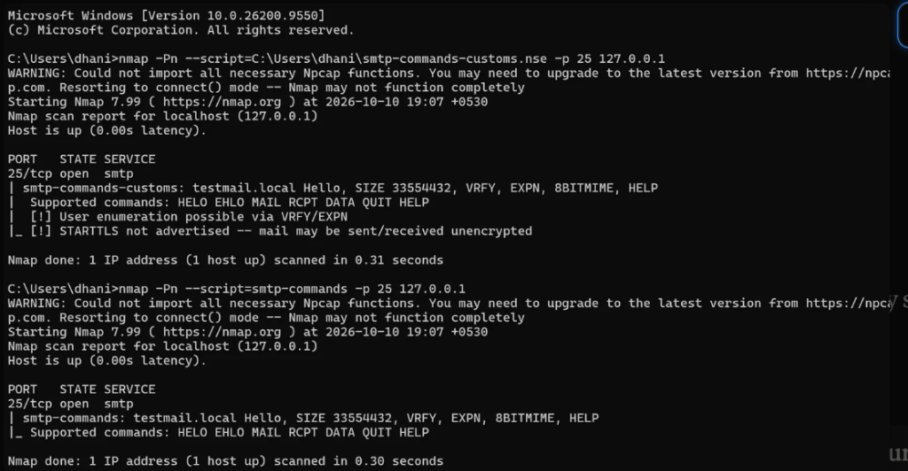
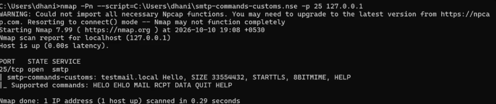
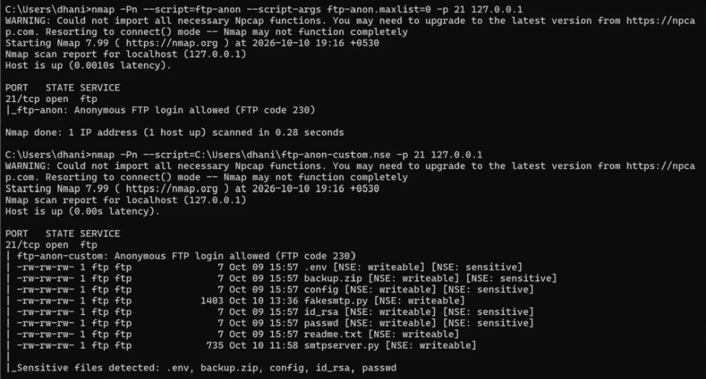

# Extending Nmap NSE: Two Custom Security Scripts for SMTP and FTP

**Author:** Dhanishkanth  
**Roll No / Registration:** 24BCE1348  
**Department:** Computer Science and Engineering, Vellore Institute of Technology (VIT), Chennai  
**Date:** October 2026  
**Tags:** `nmap`, `nse`, `cybersecurity`, `lua`, `networking`  

---

## 1. Introduction

Network reconnaissance is one of the foundational phases of any security assessment. Nmap (Network Mapper) is the industry-standard tool for discovering hosts, open ports, and running services across computer networks. Beyond basic port scanning and service banner grabbing, Nmap includes a powerful, event-driven subsystem called the **Nmap Scripting Engine (NSE)**, which executes automation scripts written in the Lua programming language.

Nmap ships out-of-the-box with over 600 scripts. However, many default discovery scripts are purely **informational**: they collect facts from the target service but do not judge whether those facts represent a security risk. For a hands-on cybersecurity assignment in my B.Tech Computer Science and Engineering program at VIT Chennai, I set out to bridge the gap between passively collecting facts and actively evaluating those facts against security best practices.

In this project, I developed two custom NSE scripts by extending existing Nmap scripts with an automated risk-evaluation layer:
1. **`smtp-risk-check.nse`** (extending `smtp-commands.nse`): Connects to an SMTP mail server, interrogates it for supported commands via `EHLO` and `HELP`, and actively flags whether user enumeration is possible via `VRFY`/`EXPN` and whether message transmission lacks `STARTTLS` encryption.
2. **`ftp-anon-plus.nse`** (extending `ftp-anon.nse`): Connects to an FTP server, authenticates anonymously, lists directory entries, and uses pattern matching to identify sensitive filenames (such as `.env`, `id_rsa`, `backup.zip`, and `passwd`), tagging each entry with `[NSE: sensitive]` and emitting a consolidated summary of detected files.

> [!NOTE]
> **Ethics and Authorization:** All scans and evaluations described in this article were conducted strictly on an isolated loopback address (`127.0.0.1`) against simulated test services I set up myself. Never scan systems or networks without explicit, written authorization from their owners.

---

To appreciate why custom NSE scripts are valuable, consider how typical vulnerability discovery workflows operate:

```
+-------------------------------------------------------------+
|                TRADITIONAL RECONNAISSANCE                   |
|  1. Connects to the service via TCP socket                  |
|  2. Sends protocol queries (e.g. EHLO, HELP, LIST)          |
|  3. Formats and prints raw server replies                   |
|  ===> Output: "Here is everything the server reported."      |
+-------------------------------------------------------------+
                              |
                              v
+-------------------------------------------------------------+
|         CUSTOM SECURITY EVALUATION LAYER (ADDED)            |
|  4. Intercepts the raw protocol data inside Lua memory      |
|  5. Evaluates features against security configuration rules |
|  6. Performs pattern matching on sensitive assets           |
|  ===> Output: "[!] User enumeration possible via VRFY/EXPN" |
|               "[!] STARTTLS not advertised"                 |
|               "[NSE: sensitive] backup.zip, id_rsa"         |
+-------------------------------------------------------------+
```

### Understanding the Anatomy of an NSE Script
Every Nmap NSE script follows a standardized Lua lifecycle:
- **Metadata:** Defines `description`, `author`, `license`, and `categories` (e.g., `{"default", "discovery", "safe"}`).
- **`portrule`:** A rule evaluated by Nmap to decide whether the script should execute against a given target port or service. For example, `shortport.port_or_service({25, 465, 587}, "smtp")`.
- **`action(host, port)`:** The main entrypoint function invoked by Nmap when the `portrule` evaluates to true. It opens network sockets, communicates via protocol libraries, processes data, and returns the formatted text or table displayed in Nmap's console output.

---

## 2. Vulnerability Context & Security Significance

### A. SMTP Security Implications
The Simple Mail Transfer Protocol (SMTP, RFC 821 / 5321) governs internet email routing. Two major misconfigurations frequently plague older or misconfigured MTAs:

1. **User Enumeration via `VRFY` and `EXPN`:**
   - The `VRFY` (Verify) command asks the mail server to verify whether a particular mailbox username exists.
   - The `EXPN` (Expand) command asks the server to list all recipient email addresses associated with a mailing alias.
   - *The Risk:* While originally intended for diagnostic debugging, malicious actors exploit `VRFY` and `EXPN` to test lists of potential usernames. If the server confirms valid mailboxes without requiring authentication, attackers can compile targeted phishing lists or brute-force dictionaries without sending a single message.
2. **Cleartext Transmission (Missing `STARTTLS`):**
   - Standard SMTP operates in cleartext over port 25. The `STARTTLS` command (RFC 3207) allows the client and server to upgrade an insecure plaintext TCP connection into an encrypted TLS tunnel before exchanging credentials or message data.
   - *The Postcard Analogy:* Sending email over unencrypted SMTP is like sending a **postcard** through the postal system—every intermediate router or proxy along the route can read and alter the message. `STARTTLS` places the letter inside a **sealed, tamper-evident envelope**. If an SMTP server fails to advertise `STARTTLS`, all communication remains vulnerable to eavesdropping and Man-in-the-Middle (MitM) inspection.

### B. FTP Security Implications
The File Transfer Protocol (FTP, RFC 959) enables direct file operations over a client-server architecture:

1. **Anonymous Access:**
   - Servers configured to permit the `anonymous` username (conventionally accompanied by an email address or empty password) grant unauthenticated users public access to the directory tree.
2. **Sensitive File Leakage:**
   - In real-world enterprise environments, administrators frequently leave temporary files, database dumps, configuration files, and backup archives in root or shared FTP directories.
   - Files like `.env` contain database credentials and API secret keys; `id_rsa` contains private SSH keys; `passwd` reveals system user accounts; and `backup.zip` often contains full site snapshots.
   - Standard Nmap scripts only check file system permissions (tagging writable directories with `[NSE: writeable]`). They do not analyze whether file names indicate sensitive confidential data.

---

## 3. Test Lab Setup

To maintain complete control, ensure reproducibility, and avoid external network dependencies, all tests were performed on an isolated local Windows environment targeting the loopback interface (`127.0.0.1`).

### Environment Specifications
- **Host OS:** Windows 11 (Build 10.0.26200.9550)
- **Scanner:** Nmap version 7.99 (Platform: `i686-pc-windows-windows`, Lua 5.4.8, OpenSSL 3.0.16)
- **Python Version:** Python 3.12.5 (used to build mock SMTP services)
- **FTP Daemon:** FileZilla Server 1.12.6
- **Test Directory:** `C:\ftp-test`

### Mock File System Setup
Under `C:\ftp-test`, I created dummy files containing the string `"test"`:
- `.env` *(Target: environment secrets)*
- `backup.zip` *(Target: compressed backup)*
- `config` *(Target: configuration file)*
- `id_rsa` *(Target: SSH private key)*
- `passwd` *(Target: UNIX password database)*
- `readme.txt` *(Control: benign file that must NOT be flagged as sensitive)*

Additionally, two testing scripts (`fakesmtp.py` and `smtpserver.py`) resided in this folder and were included in directory listings.

### Dual-Mode SMTP Simulator (`fakesmtp.py`)
To test both vulnerable and secure server responses, I wrote a multi-threaded Python daemon that simulates standard RFC response codes on port 25:

```python
import socket, sys, threading

# Accept 'risky' or 'secure' as an argument
mode = sys.argv[1] if len(sys.argv) > 1 else "risky"

if mode == "risky":
    # Advertises VRFY and EXPN, but deliberately omits STARTTLS
    EHLO = (b"250-testmail.local Hello\r\n250-SIZE 33554432\r\n"
            b"250-VRFY\r\n250-EXPN\r\n250-8BITMIME\r\n250 HELP\r\n")
else:  # secure mode
    # Advertises STARTTLS, omits VRFY and EXPN
    EHLO = (b"250-testmail.local Hello\r\n250-SIZE 33554432\r\n"
            b"250-STARTTLS\r\n250-8BITMIME\r\n250 HELP\r\n")

HELP = b"214 Supported commands: HELO EHLO MAIL RCPT DATA QUIT HELP\r\n"

def handle(conn):
    conn.sendall(b"220 testmail.local ESMTP\r\n")
    buf = b""
    while True:
        data = conn.recv(1024)
        if not data:
            break
        buf += data
        while b"\r\n" in buf:
            line, buf = buf.split(b"\r\n", 1)
            cmd = line.upper().split(b" ")[0]
            if cmd in (b"EHLO", b"HELO"):
                conn.sendall(EHLO)
            elif cmd == b"HELP":
                conn.sendall(HELP)
            elif cmd == b"QUIT":
                conn.sendall(b"221 Bye\r\n")
                conn.close()
                return
            else:
                conn.sendall(b"250 OK\r\n")
    conn.close()

s = socket.socket()
s.bind(("127.0.0.1", 25))
s.listen(5)
print(f"Fake SMTP server ({mode} mode) on 127.0.0.1:25. Ctrl+C to stop.")
while True:
    c, _ = s.accept()
    threading.Thread(target=handle, args=(c,), daemon=True).start()
```

---

## 4. Script 1: SMTP Security Checks (smtp-risk-check.nse)

### A. How the Original Script Works (`smtp-commands.nse`)
Originally written by **Jasey DePriest**, `smtp-commands.nse` operates in three linear phases:
1. **Connect:** Opens a TCP socket to port 25, 465, or 587.
2. **Query:** Sends an `EHLO` command with the local domain name, then sends a `HELP` command.
3. **Format & Return:** Uses Lua string manipulation (`gsub`) to strip SMTP status codes (`250-`, `214-`), collapses newlines into comma-separated strings, and concatenates the results into a single table. It has no security evaluation logic.

#### Full Source Code: Original `smtp-commands.nse`
```lua
local shortport = require "shortport"
local smtp = require "smtp"
local stdnse = require "stdnse"
local string = require "string"
local table = require "table"

description = [[
Attempts to use EHLO and HELP to gather the Extended commands supported by an
SMTP server.
]]

author = "Jasey DePriest"
license = "Same as Nmap--See https://nmap.org/book/man-legal.html"
categories = {"default", "discovery", "safe"}

portrule = shortport.port_or_service({ 25, 465, 587 },
  { "smtp", "smtps", "submission" })

function go(host, port)
  local options = {
    timeout = 10000,
    recv_before = true,
    ssl = true,
  }

  local domain = stdnse.get_script_args('smtp-commands.domain') or
  smtp.get_domain(host)

  local result, status = {}
  local socket, response = smtp.connect(host, port, options)
  if not socket then
    return false, string.format("Couldn't establish connection on port %i",
      port.number)
  end

  status, response = smtp.ehlo(socket, domain)
  if not status then
    return status, response
  end

  response = response:gsub("\r", "")
                     :gsub("^%s*(.-)%s*$", "%1")
                     :gsub("%f[^\0\n]250[-%s]+", "")
                     :gsub("\n", ", ")
                     :gsub("%s+", " ")
  table.insert(result, response)

  status, response = smtp.help(socket)
  if status then
    response = response:gsub("\r", "")
                       :gsub("^%s*(.-)%s*$", "%1")
                       :gsub("%f[^\0\n]214[-%s]+", "")
                       :gsub("%s+", " ")
    table.insert(result, response)
    smtp.quit(socket)
  end

  return true, result
end

action = function(host, port)
  local status, result = go(host, port)

  if not status then
    return result
  else
    if #result > 0 then
      local final = {}
      for index, test in ipairs(result) do
        table.insert(final, test)
      end
      return table.concat(final, "\n ")
    end
  end
end
```

---

### B. How the Updated Script Works (`smtp-risk-check.nse`)
In my updated script (`smtp-commands-customs.nse`), I preserved the robust connection logic inside `go()`, but introduced an evaluation function called `check_risks(combined_text)`:

1. **Combined String Inspection:** Rather than evaluating `EHLO` and `HELP` responses separately, the script merges all returned capabilities into a single normalized uppercase string.
2. **Enumeration Detection:** Checks for the presence of the keywords `VRFY` and `EXPN`. If found, it appends `[!] User enumeration possible via VRFY/EXPN`.
3. **Encryption Verification:** Checks whether `STARTTLS` is present in the response string. If absent, it appends `[!] STARTTLS not advertised -- mail may be sent/received unencrypted`.
4. **Console Output:** Appends the generated findings directly to the `final` array so they render beneath the command list.

#### Full Source Code: Updated `smtp-risk-check.nse`
```lua
local shortport = require "shortport"
local smtp = require "smtp"
local stdnse = require "stdnse"
local string = require "string"
local table = require "table"

description = [[
Attempts to use EHLO and HELP to gather the Extended commands supported by an
SMTP server, then flags two security-relevant findings:
  - User enumeration risk if VRFY or EXPN are supported
  - Unencrypted mail risk if STARTTLS is not advertised
]]

author = "Dhanishkanth (based on smtp-commands.nse by Jasey DePriest)"
license = "Same as Nmap--See https://nmap.org/book/man-legal.html"
categories = {"default", "discovery", "safe"}

portrule = shortport.port_or_service({ 25, 465, 587 },
  { "smtp", "smtps", "submission" })

function go(host, port)
  local options = {
    timeout = 10000,
    recv_before = true,
    ssl = true,
  }

  local domain = stdnse.get_script_args('smtp-commands.domain') or
  smtp.get_domain(host)

  local result, status = {}
  local socket, response = smtp.connect(host, port, options)
  if not socket then
    return false, string.format("Couldn't establish connection on port %i",
      port.number)
  end

  status, response = smtp.ehlo(socket, domain)
  if not status then
    return status, response
  end

  response = response:gsub("\r", "")
                     :gsub("^%s*(.-)%s*$", "%1")
                     :gsub("%f[^\0\n]250[-%s]+", "")
                     :gsub("\n", ", ")
                     :gsub("%s+", " ")
  table.insert(result, response)

  status, response = smtp.help(socket)
  if status then
    response = response:gsub("\r", "")
                       :gsub("^%s*(.-)%s*$", "%1")
                       :gsub("%f[^\0\n]214[-%s]+", "")
                       :gsub("%s+", " ")
    table.insert(result, response)
    smtp.quit(socket)
  end

  return true, result
end

-- =========================================================================
-- ADDED FEATURE: Security Evaluation Layer
-- =========================================================================
local function check_risks(combined_text)
  local findings = {}
  local upper_text = combined_text:upper()

  -- Check 1: User enumeration capabilities
  local risky = {}
  if upper_text:find("VRFY") then
    table.insert(risky, "VRFY")
  end
  if upper_text:find("EXPN") then
    table.insert(risky, "EXPN")
  end
  if #risky > 0 then
    table.insert(findings, "[!] User enumeration possible via " .. table.concat(risky, "/"))
  end

  -- Check 2: Transport encryption support
  if not upper_text:find("STARTTLS") then
    table.insert(findings, "[!] STARTTLS not advertised -- mail may be sent/received unencrypted")
  end

  return findings
end

action = function(host, port)
  local status, result = go(host, port)

  if not status then
    return result
  else
    if #result > 0 then
      local final = {}
      for index, test in ipairs(result) do
        table.insert(final, test)
      end

      -- Run risk check on the combined EHLO + HELP text
      local combined = table.concat(final, " ")
      local findings = check_risks(combined)

      for _, f in ipairs(findings) do
        table.insert(final, f)
      end

      return table.concat(final, "\n ")
    end
  end
end
```

---

### C. Execution & Real Output Comparison

#### Test Case 1: Risky SMTP Server
We launched `python fakesmtp.py risky` and executed both scripts:

```cmd
nmap -Pn --script=smtp-commands -p 25 127.0.0.1
nmap -Pn --script=C:\Users\dhani\smtp-commands-customs.nse -p 25 127.0.0.1
```

**Output Comparison:**
```text
[Original smtp-commands output]
PORT   STATE SERVICE
25/tcp open  smtp
| smtp-commands: testmail.local Hello, SIZE 33554432, VRFY, EXPN, 8BITMIME, HELP
|_ Supported commands: HELO EHLO MAIL RCPT DATA QUIT HELP

[Custom smtp-risk-check output]
PORT   STATE SERVICE
25/tcp open  smtp
| smtp-commands-customs: testmail.local Hello, SIZE 33554432, VRFY, EXPN, 8BITMIME, HELP
|  Supported commands: HELO EHLO MAIL RCPT DATA QUIT HELP
|  [!] User enumeration possible via VRFY/EXPN
|_ [!] STARTTLS not advertised -- mail may be sent/received unencrypted
```

  
*Figure 1: The original script prints raw commands only. The custom script prints the exact same command lists plus two clear [!] warning flags.*

#### Test Case 2: Secure SMTP Server
To verify that the script does not generate false positives, we launched `python fakesmtp.py secure`:

```cmd
nmap -Pn --script=C:\Users\dhani\smtp-commands-customs.nse -p 25 127.0.0.1
```

**Output:**
```text
PORT   STATE SERVICE
25/tcp open  smtp
| smtp-commands-customs: testmail.local Hello, SIZE 33554432, STARTTLS, 8BITMIME, HELP
|_ Supported commands: HELO EHLO MAIL RCPT DATA QUIT HELP
```

  
*Figure 2: On the secure server, the script detects STARTTLS, finds no VRFY/EXPN, and prints zero warning flags.*

---

## 5. Script 2: FTP Sensitive File Detection (tp-anon-plus.nse)

### A. How the Original Script Works (`ftp-anon.nse`)
Authored by **Eddie Bell, Rob Nicholls, Ange Gutek, and David Fifield**, `ftp-anon.nse` performs anonymous login verification:
1. **Connect & Authenticate:** Connects to port 21/990 and issues `USER anonymous` followed by `PASS IEUser@`.
2. **Directory Listing:** If login succeeds (code `230`), it opens a passive data connection via `PASV` and issues `LIST` to receive raw directory lines.
3. **Permissions Check:** Inspects the first column of the UNIX permission string using `string.match(item, "^[d-].......w.")`. If the write bit is set, it appends `[NSE: writeable]`.
4. *Limitation:* It treats all filenames identically, ignoring whether a file is a harmless text file or an exposed private key.

#### Full Source Code: Original `ftp-anon.nse`
```lua
local ftp = require "ftp"
local match = require "match"
local nmap = require "nmap"
local shortport = require "shortport"
local stdnse = require "stdnse"
local string = require "string"
local table = require "table"

description = [[
Checks if an FTP server allows anonymous logins.

If anonymous is allowed, gets a directory listing of the root directory.
]]

author = {"Eddie Bell", "Rob Nicholls", "Ange Gutek", "David Fifield"}
license = "Same as Nmap--See https://nmap.org/book/man-legal.html"
categories = {"default", "auth", "safe"}

portrule = shortport.port_or_service({21,990}, {"ftp","ftps"})

local function list(socket, buffer, target, max_lines)
  local list_socket, err = ftp.pasv(socket, buffer)
  if not list_socket then
    return nil, err
  end

  local status, err = socket:send("LIST\r\n")
  if not status then
    return status, err
  end

  local listing = {}
  while not max_lines or #listing < max_lines do
    local status, data = list_socket:receive_buf(match.pattern_limit("\r?\n", 2048), false)
    if (not status and data == "EOF") or data == "" then
      break
    end
    if not status then
      return status, data
    end
    listing[#listing + 1] = data
  end

  return true, listing
end

action = function(host, port)
  local max_list = stdnse.get_script_args("ftp-anon.maxlist")
  if not max_list then
    if nmap.verbosity() == 0 then
      max_list = 20
    else
      max_list = nil
    end
  else
    max_list = tonumber(max_list)
    if max_list < 0 then
      max_list = nil
    end
  end

  local socket, code, message, buffer = ftp.connect(host, port, {request_timeout=8000})
  if not socket then
    return nil
  end
  if code and code ~= 220 then
    return nil
  end

  local status, code, message = ftp.auth(socket, buffer, "anonymous", "IEUser@")
  if not status then
    if code == 421 or code == 530 then
      -- Don't log known error codes.
    end
    return nil
  end

  local result = {}
  result[#result + 1] = "Anonymous FTP login allowed (FTP code " .. code .. ")"

  if not max_list or max_list > 0 then
    local status, listing = list(socket, buffer, host, max_list)
    ftp.close(socket)

    if not status then
      result[#result + 1] = "Can't get directory listing: " .. listing
    else
      for _, item in ipairs(listing) do
        -- Existing writeable check
        if string.match(item, "^[d-].......w.") then
          item = item .. " [NSE: writeable]"
        end
        result[#result + 1] = item
      end
    end
  end

  return table.concat(result, "\n")
end
```

---

### B. How the Updated Script Works (`ftp-anon-plus.nse`)
In `ftp-anon-custom.nse` (referenced here as `ftp-anon-plus.nse`), I added an automated filename analysis engine:

1. **Filename Extraction (`get_entry_name`):** Uses regex `([^%s]+)$` to parse the filename from the tail of standard UNIX directory listings.
2. **Sensitive Pattern Dictionary (`SENSITIVE_PATTERNS`):** Defines a comprehensive list of Lua regex patterns targeting credential stores, configuration files, and backup archives:
   - `^%.env$` and `^%.env%.` (Docker / Node environment files)
   - `^id_rsa` and `^id_dsa` (SSH private keys)
   - `^passwd$` and `^shadow$` (UNIX user databases)
   - `^backup`, `^database`, `^secret`, `^token`, `^config` (Archive and configuration assets)
3. **Pattern Matcher (`is_sensitive`):** Evaluates extracted filenames case-insensitively against the pattern table.
4. **Tagging & Aggregation:** If a match is found, appends `[NSE: sensitive]` to the file line and pushes the filename to a `sensitive_files` tracking table.
5. **Findings Summary Footer:** After iterating through all entries, appends a dedicated summary line: `Sensitive files detected: <list of files>`.

#### Full Source Code: Updated `ftp-anon-plus.nse`
```lua
local ftp = require "ftp"
local match = require "match"
local nmap = require "nmap"
local shortport = require "shortport"
local stdnse = require "stdnse"
local string = require "string"
local table = require "table"

description = [[
Checks if an FTP server allows anonymous logins.

If anonymous is allowed, gets a directory listing of the root directory,
highlights writeable files, and flags filenames that look sensitive
(backups, credentials, configs, private keys).
]]

author = {"Eddie Bell", "Rob Nicholls", "Ange Gutek", "David Fifield", "Modified by Dhanishkanth"}
license = "Same as Nmap--See https://nmap.org/book/man-legal.html"
categories = {"default", "auth", "safe"}

portrule = shortport.port_or_service({21,990}, {"ftp","ftps"})

local function list(socket, buffer, target, max_lines)
  local list_socket, err = ftp.pasv(socket, buffer)
  if not list_socket then
    return nil, err
  end

  local status, err = socket:send("LIST\r\n")
  if not status then
    return status, err
  end

  local listing = {}
  while not max_lines or #listing < max_lines do
    local status, data = list_socket:receive_buf(match.pattern_limit("\r?\n", 2048), false)
    if (not status and data == "EOF") or data == "" then
      break
    end
    if not status then
      return status, data
    end
    listing[#listing + 1] = data
  end

  return true, listing
end

-- =========================================================================
-- ADDED FEATURE: Helper to extract filename from directory listing
-- =========================================================================
local function get_entry_name(item)
  if not item then
    return nil
  end

  local name = string.match(item, "([^%s]+)$")
  if not name then
    return item
  end

  return name
end

-- =========================================================================
-- ADDED FEATURE: Sensitive Pattern Dictionary & Evaluator
-- =========================================================================
local SENSITIVE_PATTERNS = {
  "^%.env$", "^%.env%.", "^%.htaccess$", "^id_rsa", "^id_dsa",
  "^passwd$", "^shadow$", "^%.ssh$", "^config$", "^backup",
  "^database", "^secret", "^token", "^private", "^pass$", "^pwd$",
}

local function is_sensitive(name)
  local lower = string.lower(name)
  for _, pattern in ipairs(SENSITIVE_PATTERNS) do
    if lower:match(pattern) then
      return true
    end
  end
  return false
end

action = function(host, port)
  local max_list = stdnse.get_script_args("ftp-anon.maxlist")
  if not max_list then
    if nmap.verbosity() == 0 then
      max_list = 20
    else
      max_list = nil
    end
  else
    max_list = tonumber(max_list)
    if max_list < 0 then
      max_list = nil
    end
  end

  local socket, code, message, buffer = ftp.connect(host, port, {request_timeout=8000})
  if not socket then
    return nil
  end
  if code and code ~= 220 then
    return nil
  end

  local status, code, message = ftp.auth(socket, buffer, "anonymous", "IEUser@")
  if not status then
    if code == 421 or code == 530 then
      -- Don't log known error codes.
    end
    return nil
  end

  local result = {}
  result[#result + 1] = "Anonymous FTP login allowed (FTP code " .. code .. ")"

  local sensitive_files = {}

  if not max_list or max_list > 0 then
    local status, listing = list(socket, buffer, host, max_list)
    ftp.close(socket)

    if not status then
      result[#result + 1] = "Can't get directory listing: " .. listing
    else
      for _, item in ipairs(listing) do
        local entry_name = get_entry_name(item)

        -- Existing writeable check
        if string.match(item, "^[d-].......w.") then
          item = item .. " [NSE: writeable]"
        end

        -- Added: sensitive filename check
        if entry_name and is_sensitive(entry_name) then
          item = item .. " [NSE: sensitive]"
          sensitive_files[#sensitive_files + 1] = entry_name
        end

        result[#result + 1] = item
      end
    end
  end

  -- Added: summary line for sensitive files found
  if #sensitive_files > 0 then
    result[#result + 1] = ""
    result[#result + 1] = "Sensitive files detected: " .. table.concat(sensitive_files, ", ")
  end

  return table.concat(result, "\n")
end
```

---

### C. Execution & Real Output Comparison
To demonstrate the difference clearly:
- We ran the original `ftp-anon.nse` with `--script-args ftp-anon.maxlist=0` (suppressing directory listings to show minimal stock output).
- We ran `ftp-anon-custom.nse` against the real FileZilla Server directory containing both sensitive files (`.env`, `backup.zip`, `config`, `id_rsa`, `passwd`) and non-sensitive files (`readme.txt`, `fakesmtp.py`, `smtpserver.py`).

```cmd
nmap -Pn --script=ftp-anon --script-args ftp-anon.maxlist=0 -p 21 127.0.0.1
nmap -Pn --script=C:\Users\dhani\ftp-anon-custom.nse -p 21 127.0.0.1
```

**Observed Output Comparison:**
```text
[Original ftp-anon (with maxlist=0)]
PORT   STATE SERVICE
21/tcp open  ftp
|_ftp-anon: Anonymous FTP login allowed (FTP code 230)

[Custom ftp-anon-custom output]
PORT   STATE SERVICE
21/tcp open  ftp
| ftp-anon-custom: Anonymous FTP login allowed (FTP code 230)
| -rw-rw-rw- 1 ftp ftp               7 Oct 09 15:57 .env [NSE: writeable] [NSE: sensitive]
| -rw-rw-rw- 1 ftp ftp               7 Oct 09 15:57 backup.zip [NSE: writeable] [NSE: sensitive]
| -rw-rw-rw- 1 ftp ftp               7 Oct 09 15:57 config [NSE: writeable] [NSE: sensitive]
| -rw-rw-rw- 1 ftp ftp            1403 Oct 10 13:36 fakesmtp.py [NSE: writeable]
| -rw-rw-rw- 1 ftp ftp               7 Oct 09 15:57 id_rsa [NSE: writeable] [NSE: sensitive]
| -rw-rw-rw- 1 ftp ftp               7 Oct 09 15:57 passwd [NSE: writeable] [NSE: sensitive]
| -rw-rw-rw- 1 ftp ftp               7 Oct 09 15:57 readme.txt [NSE: writeable]
| -rw-rw-rw- 1 ftp ftp             735 Oct 10 11:58 smtpserver.py [NSE: writeable]
| 
|_Sensitive files detected: .env, backup.zip, config, id_rsa, passwd
```

  
*Figure 3: Original ftp-anon reports only that anonymous login is allowed (with maxlist=0), while the custom script inspects the files, tags each sensitive filename, and prints a consolidated summary of findings.*

---

## 6. Comparative Analysis: Original vs. Updated Scripts

| Evaluation Dimension | Original `smtp-commands.nse` | Updated `smtp-risk-check.nse` | Original `ftp-anon.nse` | Updated `ftp-anon-plus.nse` |
| :--- | :--- | :--- | :--- | :--- |
| **Primary Goal** | Command discovery | Security configuration check | Anonymous access check | Sensitive data exposure detection |
| **Protocol Queries** | `EHLO`, `HELP` | `EHLO`, `HELP` | `USER`, `PASS`, `LIST` | `USER`, `PASS`, `LIST` |
| **Logic Layer** | String formatting only | String formatting + Boolean rule evaluation | Permission bit parsing (`[NSE: writeable]`) | Permission bit parsing + Regex pattern evaluation |
| **User Enumeration Check** | None (lists commands) | Flags `VRFY`/`EXPN` capabilities | N/A | N/A |
| **Encryption Verification** | None (lists commands) | Flags missing `STARTTLS` | N/A | N/A |
| **Filename Security Check** | N/A | N/A | None | Checks 16 regex patterns |
| **Summary Reporting** | None | Appends `[!]` flags | None | Appends `Sensitive files detected: ...` |

---

## 7. Step-by-Step Installation & Running Guide on Windows

### Step 1: Placing the Scripts
Save the scripts in your Windows user directory (`%USERPROFILE%` / `C:\Users\<username>\`):
- `C:\Users\<username>\smtp-risk-check.nse`
- `C:\Users\<username>\ftp-anon-plus.nse`

*(Alternatively, copy them into `C:\Program Files (x86)\Nmap\scripts\` which requires Administrator rights, and run `nmap --script-updatedb`).*

### Step 2: Executing via Command Prompt
```cmd
:: Scan SMTP on port 25, 465, or 587
nmap -Pn --script=%USERPROFILE%\smtp-risk-check.nse -p 25,465,587 127.0.0.1

:: Scan FTP on port 21 or 990
nmap -Pn --script=%USERPROFILE%\ftp-anon-plus.nse -p 21,990 127.0.0.1
```

> **Why `-Pn`?** On Windows, local firewall rules frequently drop ICMP Echo requests (pings) even when ports are open. The `-Pn` flag instructs Nmap to skip host ping discovery and scan ports directly.

---

## 8. Real Engineering Challenges & Troubleshooting

During the implementation and testing of these scripts, several practical obstacles arose:

1. **"Host seems down" and "Filtered" Ports:**  
   My first scan targeted my PC's LAN IP. Nmap reported the host as down, and adding `-Pn` showed ports as `filtered`. Windows Firewall blocks inbound connection requests across external adapters by default, and no services were bound there. Binding test servers explicitly to `127.0.0.1` and using `-Pn` resolved this.
2. **Silent FTP Failures (The 530 Login Code):**  
   At first, both `ftp-anon.nse` and my custom script printed no output under port 21. A manual login with a blank password worked, so I tested Nmap's exact credentials using curl:
   ```cmd
   curl -v --user anonymous:IEUser@ ftp://127.0.0.1/
   ```
   FileZilla responded with `530 Login incorrect`. In `ftp-anon.nse`, return code `530` causes the script to exit silently with `return nil`. Because Nmap suppresses script output entirely when `action()` returns `nil`, an authentication rejection looks identical to a script failure. Modifying FileZilla Server's anonymous user settings to accept `IEUser@` fixed the issue.
3. **Non-Standard SMTP HELP Codes & Stale Socket Locks:**  
   Testing with Python's `aiosmtpd` caused `HELP` to reply with status code `250` instead of the RFC 821 standard code `214`. Nmap's `smtp.help()` function expects `214`, so the HELP response was discarded. Furthermore, subsequent runs failed with `[WinError 10048] Only one usage of each socket address is normally permitted` because a background Python process held port 25. I terminated the process with `taskkill /PID <pid> /F` and built `fakesmtp.py` to ensure standard RFC codes were returned.
4. **Script Naming and Lookup Rules:**  
   Attempting to run script variants produced `did not match a category, filename, or directory`. When passing script filenames, Nmap requires the exact file path if the script is not registered in Nmap's central database. Using `dir C:\Users\dhani\*.nse*` allowed me to verify exact names and pass absolute paths.
5. **Npcap Warning Notice:**  
   Every run printed `WARNING: Could not import all necessary Npcap functions... Resorting to connect() mode`. While raw packet features (such as SYN stealth scans `-sS`) require full driver access, standard TCP connect scans (`-sT`) and application-layer NSE scripts function normally in fallback mode.

---

## 9. Limitations & Future Work

- **VRFY Advertised vs. Functioning:** The script flags `VRFY` whenever it is advertised. Some mail servers advertise `VRFY` but return generic `252` responses to foil enumeration. A future enhancement could issue a test probe (e.g., `VRFY fakeuser12345`) to verify whether user existence is actually confirmed.
- **Root Directory Limitation:** `ftp-anon-plus.nse` currently inspects only the root directory (`/`). In enterprise setups, sensitive files are often nested inside subdirectories (e.g., `/pub/backups/`). Adding shallow recursive traversal would improve detection.
- **Content Inspection:** Filename checks cannot detect sensitive information hidden inside generic filenames. Integrating basic regex inspection on file content samples could uncover leaked credentials.

---

## 10. Ethics & Legal Notice

Scanning networks without authorization is illegal under computer crime statutes (such as the IT Act in India and the CFAA in the United States). Always obtain written permission before scanning any target outside your own local lab environment.

---

## 11. Acknowledgements & Credits

These scripts build directly on the foundation provided by the Nmap open-source project:
- **`smtp-commands.nse`:** Originally authored by **Jasey DePriest**.
- **`ftp-anon.nse`:** Originally authored by **Eddie Bell**, **Rob Nicholls**, **Ange Gutek**, and **David Fifield**.

Source code and lab test files are maintained on GitHub:  
👉 **[https://github.com/dhanish0104/nmap-nse-audit-scripts](https://github.com/dhanish0104/nmap-nse-audit-scripts)**

---

## 12. Conclusion

Extending Nmap NSE scripts in Lua demonstrates how network reconnaissance can be upgraded to deliver actionable security insights with minimal code overhead. By combining RFC protocol knowledge with simple pattern matching, we transformed basic data-collection scripts into actionable audit tools. Hands-on testing highlighted crucial engineering lessons in socket handling, firewall behavior, authentication quirks, and defensive server configuration.
